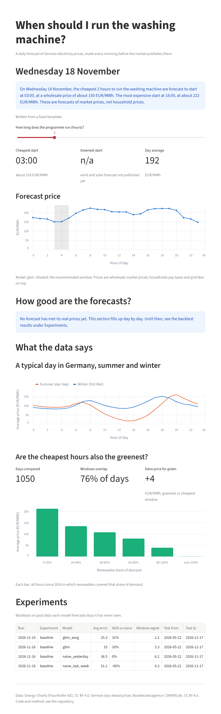

# Power hours: when should I run the washing machine?

> **Status: work in progress.** The pipeline runs; the analysis and results below are still to come.

My aunt in Norway told me she runs her washing machine at night because electricity is
cheaper then. I wanted to know whether the same rule holds in Germany, and whether I
could predict tomorrow's cheapest hours before the market publishes them.

This project:

1. collects German day-ahead electricity prices, the generation mix, and the grid
   operators' forecasts of solar, wind and demand, every day,
2. forecasts tomorrow's 24 hourly prices each morning, before the auction results are out,
3. recommends the cheapest and the greenest window for a 1 to 6 hour appliance run,
4. keeps score: every forecast is saved and later compared with what really happened,
5. writes a short daily briefing with an LLM and checks every number in it automatically,
6. compares the daily price pattern in Germany with Norway.



<!-- TODO (you): add the link to the live app here once it is deployed. -->

## Results

<!-- TODO (you): fill this in from your own backtest and analysis. Suggested content:
- a table from `python -m powerhours.backtest --days 180`
- one chart: typical day in Germany vs Norway
- two or three sentences on what you found and what surprised you -->

*Not filled in yet.*

## How it works

```
Energy-Charts API ──> ingest ──> Parquet files (data/) ──> DuckDB (SQL analysis)
                                        │
                                        ├──> features ──> models ──> backtest ──> experiment log
                                        │
                                        └──> daily forecast ──> saved, later scored
                                                   │
                                                   ├──> facts ──> LLM briefing ──> number check
                                                   │
                                                   └──> dashboard
```

A GitHub Actions job runs twice every morning (07:10 and 09:20 UTC, both before bids
close at noon German time): it downloads the newest data, makes tomorrow's forecast,
writes the briefing and commits everything to this repository.

| Part | File | What it does |
|---|---|---|
| API client | `src/powerhours/client.py` | Talks to the API, respects its rate limit |
| Storage | `src/powerhours/store.py` | Monthly Parquet files, queried with DuckDB |
| Ingestion | `src/powerhours/ingest.py` | Prices, generation mix, solar/wind/demand forecasts |
| Features | `src/powerhours/features.py` | Past prices, calendar, renewable forecasts; no leakage |
| Models | `src/powerhours/models.py` | Two naive baselines, two gradient boosting models |
| Backtest | `src/powerhours/backtest.py` | Walk-forward evaluation |
| Experiments | `src/powerhours/experiment.py` | Logs every backtest to `experiments/log.jsonl` |
| Window | `src/powerhours/window.py` | Cheapest/greenest window and the "regret" metric |
| Green | `src/powerhours/green.py` | Are the cheapest hours also the greenest? |
| Daily job | `src/powerhours/forecast.py` | Forecast, save, score |
| Briefing | `src/powerhours/briefing.py` | LLM text from computed facts, with a grounding check |
| Dashboard | `app/streamlit_app.py` | Streamlit app |

### Using an LLM without trusting it blindly

The briefing is the only place an LLM is used, and it never computes anything. The
code works out every number first (cheapest window, prices, wind and solar share).
The LLM turns those facts into three or four sentences. Then a check extracts every
number from the text and rejects the text if any number is not among the facts, or if
the cheapest start time is missing. Rejected texts are logged and replaced by a fixed
template, so I can measure how often the LLM passes.

### The metric I care about

Mean absolute error tells you how wrong the prices are. But the question is about
*timing*: a forecast can be off by 20 EUR/MWh at every hour and still pick the right
window. So besides MAE I report **window regret**: how much more you pay by running the
machine in the window the forecast recommends instead of the truly cheapest one.

## Run it yourself

```bash
python -m venv .venv
source .venv/bin/activate            # Windows: .venv\Scripts\activate
pip install -e ".[dev,app]"

pytest                                   # tests, no internet needed
streamlit run app/streamlit_app.py       # the German data is already in the repository

python -m powerhours.experiment run --name "my idea" --days 180   # backtest and log it
python -m powerhours.experiment list
python -m powerhours.forecast
python -m powerhours.briefing

# Norway stays on your own computer (restricted licence, see below):
python -m powerhours.ingest backfill --zone NO2 --start 2024-01-01
```

The API allows two requests per minute per endpoint, so downloads pause between requests.
The briefing uses the LLM only if `ANTHROPIC_API_KEY` is set (and `pip install -e ".[llm]"`);
otherwise it falls back to the template.

## Data and licence

- Source: [Energy-Charts](https://www.energy-charts.info) by Fraunhofer ISE.
- German (DE-LU) day-ahead prices: Bundesnetzagentur | SMARD.de, CC BY 4.0.
- Generation and forecast data: energy-charts.info, CC BY 4.0.
- Norwegian prices are restricted to private and internal use by the API's terms, so
  they are stored in `data/private/`, which is git-ignored, and are not part of this
  repository.

## How this was built

I built this project with the help of AI assistants (Claude). The first working version
of the pipeline was generated in one evening; I then read and tested every part, and the analysis,
modelling decisions and conclusions are mine. `LEARNING_LOG.md` records what I decided,
what went wrong and what I learned along the way.

<!-- TODO (you): keep this section true. Edit it to describe what you actually did. -->
